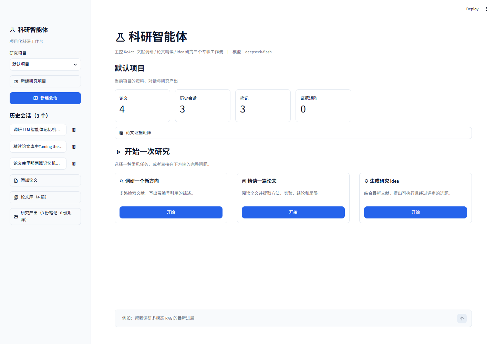
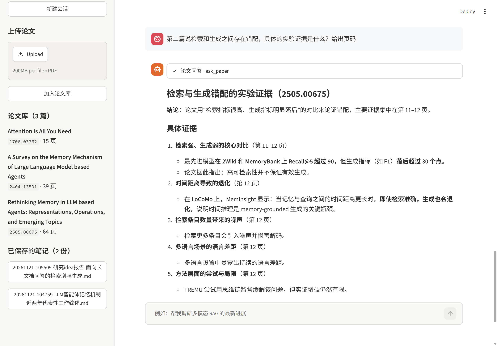
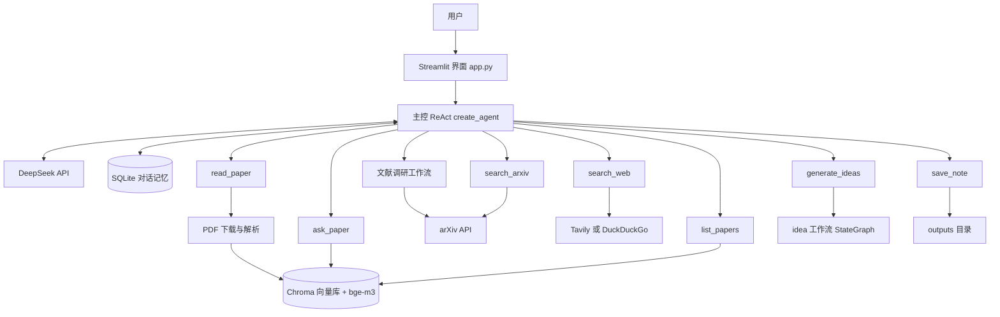
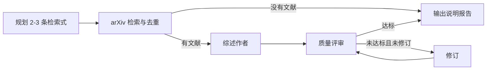
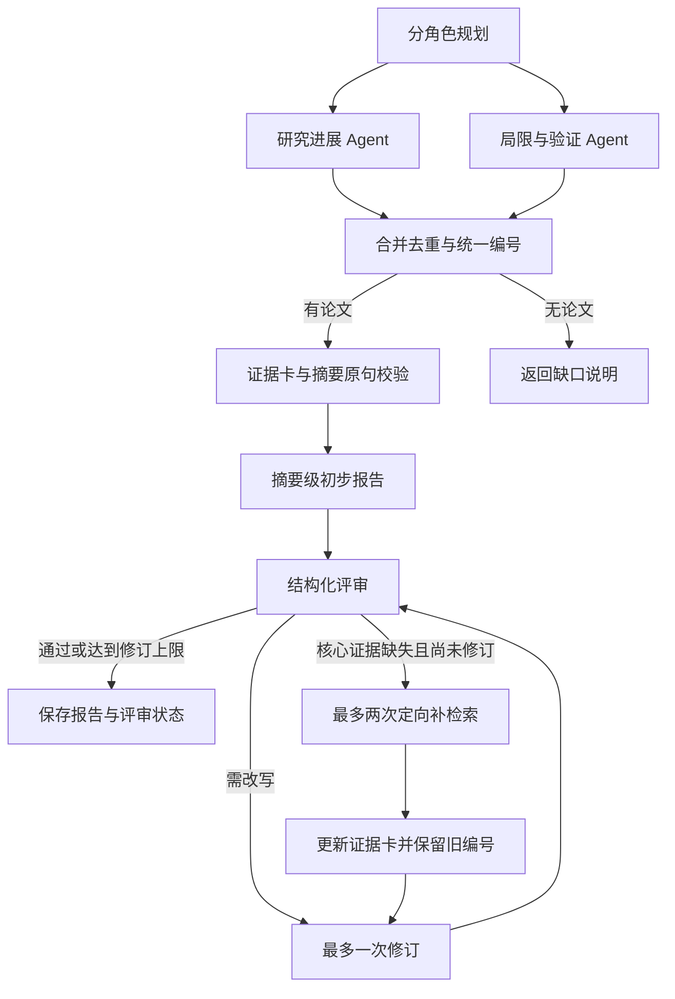
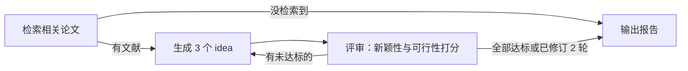

# 科研智能体（Research Agent）

一个支持本地与服务器部署的科研助手，起源于《大模型智能体与具身智能》课程项目。主控 ReAct Agent 将自然语言请求路由给文献调研、论文精读和研究 idea 工作流，结果可保存为 Markdown 笔记或 CSV 证据矩阵。

文献调研提供固定工作流与双 Agent 两种模式：双 Agent 分别调查研究进展、局限与验证，再通过证据整理、结构化评审及有限修订生成摘要级初步报告。

- 大模型：DeepSeek API
- 智能体框架：LangChain `create_agent` + LangGraph
- 论文库：PyMuPDF 解析 + Chroma 向量库 + 本地 `BAAI/bge-m3` 向量模型
- 界面：Streamlit 网页

## 本次更新（2026-11-21）

- **独立调查**：两个研究 Agent 各自维护消息历史，根据搜索结果决定后续查询；主 Agent 与其他工具接口保持兼容。
- **有界执行**：角色检索预算、共享限流与查询缓存；局部失败保留证据，结构化输出错误最多纠正重试一次。
- **证据与评审闭环**：摘要原句校验、直接/相邻任务区分、可定位的评审意见、逐条复审；必要时最多追加两次定向检索。
- **部署与验证**：完成 Linux 服务器部署和真实 API 验证；最新完整回归在服务器环境通过 **151 项测试**。

默认仍为 `LITERATURE_MODE=workflow`。要体验多智能体，在 `.env` 中设置 `LITERATURE_MODE=multi_agent` 后重启。



## 功能

| 工具 | 作用 |
| --- | --- |
| `research_literature` | 完整文献调研：规划多条检索式、检索 arXiv、去重、写带编号引用的综述、质量评审和修订，并自动保存笔记 |
| `search_arxiv` | 在 arXiv 上检索论文，返回标题、作者、日期、摘要和链接 |
| `search_web` | 搜索网页资料。配置了 Tavily Key 时用 Tavily，否则退回 DuckDuckGo |
| `read_paper` | 读入一篇论文（arXiv 编号、PDF 链接、本地路径或已入库的 paper_id），加入论文库并输出结构化精读笔记 |
| `ask_paper` | 针对论文库里的内容提问，回答附带出处页码 |
| `compare_papers` | 对 2–6 篇已入库论文做横向对比，附页码来源 |
| `build_evidence_matrix` | 从 2–6 篇论文抽取研究问题、方法、数据、指标、发现和局限，并保存 CSV |
| `list_papers` | 列出论文库里已有的论文 |
| `generate_ideas` | 围绕一个主题生成研究 idea 报告（见下面的工作流） |
| `save_note` | 把综述、笔记、报告保存到 `outputs/` 下的 Markdown 文件 |

界面上还可以直接上传 PDF 加入论文库、查看论文库、下载单份笔记，或把所有笔记一次打包成 ZIP。

### 研究项目

侧边栏可以创建和切换多个研究项目。每个项目分别管理：

- 论文库与论文原文；
- 历史会话；
- Markdown 笔记；
- 证据矩阵 CSV。

升级前的论文、会话和笔记会自动归入“默认项目”。新项目的向量块带独立的 `project_id`，
即使两个项目里有同名论文，也不会互相覆盖或检索串库。

### 论文证据矩阵

在页面主区域选择当前项目中的 2–6 篇论文，指定“检索方法”“评测设计”等关注点，
可以直接生成结构化证据表：

- 研究问题
- 核心方法
- 数据集
- 评价指标
- 主要发现
- 局限

页面会展示矩阵、综合比较和选择建议，同时保存带 UTF-8 BOM 的 CSV，方便直接使用 Excel 打开。

对话记录保存在本地 SQLite 里，刷新页面或重启程序后仍能接着聊。侧边栏的“历史会话”列出所有提过问的会话（以第一个问题作标题，最近用过的排在前面）：

- 点“新建会话”开始一段新对话，旧会话仍留在列表里；
- 点会话标题切换回去，原来的对话记录和工具调用过程都在，可以接着追问；
- 点会话右侧的垃圾桶图标并再确认一次，会删除这个会话，删除后对话记录无法恢复。论文库和已保存的笔记不受影响。



上图是真实运行的截图：在同一会话里追问“第二篇说检索和生成之间存在错配，具体的实验证据是什么”，智能体根据上文知道“第二篇”指哪篇论文，调用 `ask_paper` 后给出带页码的回答。

## 架构



主控智能体是一个标准的 ReAct 工具调用循环：模型看到对话和工具说明后决定把任务交给哪个能力，拿到结果后继续思考，直到给出最终回答。三个主要任务采用不同的协作结构：

- `research_literature`：固定检索或双 Agent 调查 → 去重；多智能体模式继续整理证据卡 → 写作 → 评审 → 按需补检索 → 最多一次修订。
- `generate_ideas`：检索规划 → idea 生成者 → 顶会审稿人角色 → 不达标时修订，最多两轮。
- `read_paper` / `ask_paper`：单篇论文精读采用分段阅读与合并；论文问答采用向量检索、原文依据和页码出处。

需要探索的检索阶段使用独立 Agent；步骤明确的写作、评审和修订使用固定状态图。角色通过结构化产物交接，不依赖自由聊天式协商。主控循环的保护位于 `research_agent/agent.py`，子 Agent 的限制位于 `research_agent/workflows/research_workers.py`：

- **工具出错不中断对话**：工具抛出的异常会被中间件转成一条“工具失败”的消息交还给模型，由模型换个办法或如实告诉用户。
- **高成本能力有独立预算**：`read_paper` 每轮最多 5 次，`research_literature` 和 `generate_ideas` 每轮各最多 1 次，全部工具合计最多 20 次。超出的调用会被拒绝，模型用已有信息把回答写完。
- **引用由代码校验**：综述正文中越界的引用编号会被删除，参考文献列表只保留实际引用且确实来自检索结果的论文。

### 文献调研：固定模式

`LITERATURE_MODE=workflow` 时，`research_literature` 使用以下 LangGraph 多角色状态图：



- 最早 10 篇去重文献会作为唯一事实来源，作者只能引用这些编号。
- 评审从主题覆盖、证据一致性、结构清晰度三个维度检查，不通过时带着具体意见修订一次。
- 最终生成的综述自动保存为 `outputs/<时间戳>-文献综述-<主题>.md`，无需再手动调用保存工具。
- 同一秒生成同名笔记时自动追加序号，不会静默覆盖旧文件。

### 可选：多智能体文献调研

在 `.env` 中设置 `LITERATURE_MODE=multi_agent` 并重启程序，即可让
`research_literature` 使用两个独立的工具调用 Agent：研究进展 Agent 和局限与验证 Agent。
默认 `LITERATURE_MODE=workflow` 保留原有固定检索流程，便于对照实验。



每个调查 Agent 仅能使用只读 arXiv 检索，每次最多返回 5 篇论文，最多调用 3 次；
两个 Agent 合计最多 6 次逻辑检索。底层 arXiv 函数仍可能进行重试和宽松查询回退，
因此该数字不是 HTTP 请求总数。两者的逻辑检索共享串行限流，启动间隔至少 3 秒。
每个 Agent 最多 4 轮决策及 1 次结构化交接，不允许递归委派或写入论文库。

调查使用 120 秒的协作式时间预算：开始新调用前检查预算，已在运行的同步模型或
网络请求仍等待其自身超时，不保证 120 秒内硬中断。摘要交接失败时保留已经取得的论文。
单个角色失败会生成带缺口说明的报告；没有论文时不调用写作者。

来源元数据直接取自检索工具，模型只能提交引用这些来源的发现。
合并时跨 arXiv 版本去重，并轮流选择两个角色的来源，首轮总计最多 10 篇。
含未知来源的发现、引用未进入最终文献集的发现不会送入写作；引用存在性校验并不能
证明结论正确，写作与评审仍须对照摘要。报告明确标注摘要级证据，附角色状态、退出原因、
耗时和错误；检索式记录在报告开头。未增加全文核验或自动复现能力。

模式只影响文献调研，其他工具与主 Agent 接口保持不变。

#### 检索与评审质量闭环

- 规划节点分别给进展角色分配方法/适用范围查询、给局限角色分配评测/失败查询。
  后续查询要求根据已发现的方法、基准或缺口调整。两者共享本次任务的查询缓存
  （大小写及空白归一化），相同查询复用结果；失败不缓存。缓存命中仍计入角色的三次调用预算。
- 合并后提取证据卡，列出任务设定、直接/相邻相关性、有限结论、原文片段、作者问题陈述或
  作者结果、未知项。代码核对来源 ID 与原文片段存在性；分类及语义支持关系仍需模型/人工审核。
  不通过校验的卡片标为未知。相邻任务不直接排名，没搜到不等于领域不存在。
- 评审意见包含稳定编号、章节、原句、问题类型、处理动作、阻断/建议等级及解决状态。
  复审会收到上一轮意见；遗漏的未解决阻断项继续保留。低评分或未解决阻断项不能通过，
  仅建议项不单独阻断范围已声明的初步调研。
- 只有阻断项明确要求补证据时，最多进行两次非重复的定向检索，每次最多追加一篇新来源；
  保持已有引用编号不变，最多由10篇增至12篇，然后重新整理证据并修订一次。
  补检索失败/无结果时要求删除或缩小无依据结论，不无限循环，也不自动放宽评审。
- 报告保存证据卡、查询与缓存命中、补检索情况和逐条修订状态。
  本流程仍是摘要级初步调研，不声称完成全文核验或系统综述。

### idea 工作流（固定流程）

`generate_ideas` 内部是一个单独的 LangGraph 状态图，把“先查文献、再想点子、再自我审查”固定成流程：



- 检索：模型把主题改写成最多 3 条英文检索式，在 arXiv 上各查 5 篇，去重后最多保留 10 篇。
- 生成：基于这些论文提出 idea，每个 idea 必须注明参考了哪几篇。
- 评审：另一轮模型调用按 1–5 分给新颖性和可行性打分并写出意见。新颖性不低于 4 且可行性不低于 3 才算达标，否则带着评审意见重新修订，最多修订 2 轮。
- 报告：参考文献列表直接取自检索结果，idea 里引用了不存在的编号会被去掉；一篇文献都没检索到时不会凭空生成 idea。

### 论文处理

- 论文先完整解析成功才会写入 `data/papers/`，损坏的文件不会留下残留。
- 按页切块（每块约 1200 字符），每块带页码，所以问答能给出出处页码。
- 精读时论文不超过 12 万字符就一次读完，更长的分段做笔记再合并。
- 向量模型在第一次需要计算向量时才加载，只聊天、只检索时不会占用显存。

## 目录结构

```text
app.py                      Streamlit 界面
research_agent/
  config.py                 读取 .env 配置
  projects.py               项目清单、当前项目上下文、项目目录
  evidence.py               证据矩阵抽取、CSV 导出
  llm.py                    DeepSeek 模型
  prompts.py                全部提示词
  agent.py                  主控 ReAct、对话记忆、流式事件、调用预算
  tools/                    literature.py  evidence.py  search.py  paper.py  idea.py  notes.py
  paper/                    loader.py（下载、解析、切块）  store.py（向量库）
  workflows/
    idea_graph.py           固定 idea 生成与评审流程
    literature_graph.py     模式路由、写作、结构化评审与有限补检索
    research_workers.py     两个独立研究 Agent、预算与查询缓存
    research_evidence.py    证据卡模型、来源与摘要原句校验
scripts/run_demos.py        连通性自检与三个演示场景
tests/                      单元测试
docs/                       界面截图和三个演示场景的真实运行记录
data/                       运行时生成：论文 PDF、向量库、对话记录（不提交）
outputs/                    运行时生成：保存的笔记和演示记录（不提交）
```

## 安装

需要 Anaconda 或 Miniconda。有 NVIDIA 显卡时向量模型会自动用 GPU，没有也能用 CPU 运行，只是论文入库慢一些。

```powershell
# 1. 创建环境（environment.yml 里用的是清华镜像）
conda env create -f environment.yml
conda activate research-agent

# 2. 安装 PyTorch。按自己的显卡和驱动到 https://pytorch.org 选择命令，例如 CUDA 13.0：
pip install torch --index-url https://download.pytorch.org/whl/cu130
#    没有显卡：pip install torch --index-url https://download.pytorch.org/whl/cpu

# 3. 安装其余依赖
pip install -r requirements.txt
```

## 配置

把 `.env.example` 复制为 `.env`，填入 Key：

| 变量 | 说明 |
| --- | --- |
| `DEEPSEEK_API_KEY` | 必填，在 <https://platform.deepseek.com/api_keys> 申请 |
| `DEEPSEEK_MODEL` | 默认 `deepseek-flash`，可改为 `deepseek-v4-pro` |
| `LITERATURE_MODE` | 默认 `workflow`；设为 `multi_agent` 启用双 Agent 文献调研 |
| `TAVILY_API_KEY` | 选填。不填时网页搜索用 DuckDuckGo，国内网络下可能连不上 |
| `EMBEDDING_MODEL` | 默认 `BAAI/bge-m3` |
| `HF_ENDPOINT` | 选填。下载向量模型慢时可填 `https://hf-mirror.com` |
| `DATA_DIR`、`OUTPUT_DIR` | 数据和输出目录，默认 `data`、`outputs` |

`.env` 已写入 `.gitignore`，不会被提交。修改 `.env` 后需要重启程序才生效。
填写创建密钥时获得的完整值，控制台列表里的星号是掩码，不能作为密钥使用。
进程环境变量可能覆盖 `.env`；部署时应核对实际进程读取的配置，不在日志中打印密钥。

## 运行

```powershell
conda activate research-agent
streamlit run app.py
```

浏览器打开 <http://localhost:8501> 后直接提问，或点击页面上的示例问题。

配置好 Key 后，建议先跑一次自检，它会用真实 API 依次检验普通对话、工具调用、结构化输出三种调用方式：

```powershell
python -m scripts.run_demos --check
```

Linux 后台运行、Supervisor 管理和 SSH 隧道访问见 [服务器部署说明](docs/deployment.md)。
服务进程重启不等于正在运行的调研任务可恢复；执行长任务时应避免重启服务。

### 调研状态说明

工具步骤成功完成与内容评审通过是两件事。报告即使仍有未解决意见，也可能正常保存。
当前历史步骤会把“尚未收到工具结果”也显示为红色感叹号；展开后若显示“这一步没有执行完”，
可能仍在等待结果，也可能已中断，不能仅凭图标判断失败。若稍后出现报告，则任务已经完成。

## 演示

`scripts/run_demos.py` 会在自检通过后依次跑三个场景，并把完整过程（每一步工具调用的参数、结果和最终回答）保存到 `outputs/demo/scenario-N.md`，智能体自己保存的笔记在 `outputs/` 下：

```powershell
python -m scripts.run_demos                # 跑全部三个场景，约 4 分钟
python -m scripts.run_demos --scenario 3   # 只跑第 3 个场景
```

下面是早期版本使用 `deepseek-flash` 的真实演示记录，原始内容保存在 `docs/demo/`。
其中工具调用次数和选文数量不代表当前版本的预算；当前双 Agent 验证见后文。
大模型输出和联网检索结果会变化，重新运行不保证一致。

| 场景 | 提问 | 智能体做了什么 | 记录 |
| --- | --- | --- | --- |
| 1. 文献调研并保存综述 | 调研 LLM 智能体记忆机制方向近两年的代表性工作，写一份简短综述并保存成笔记 | 检索 arXiv 4 次，精读 2 篇核心综述，写出综述并保存 | [过程](docs/demo/scenario-1.md)、[综述笔记](docs/demo/note-survey.md) |
| 2. 精读论文并追问细节 | 先“精读 arXiv 论文 1706.03762”，再追问 base 模型的注意力头数、优化器和学习率调整方式，并要求给出页码 | 下载论文、入库、输出精读笔记；追问时调用 `ask_paper` 从原文片段作答 | [过程](docs/demo/scenario-2.md) |
| 3. 生成研究 idea | 围绕“面向长文档问答的检索增强生成”给出几个适合硕士生做的研究 idea，并保存报告 | idea 工作流用 3 条检索式找到 10 篇文献，生成 3 个 idea 并修订 2 轮，保存报告 | [过程](docs/demo/scenario-3.md)、[idea 报告](docs/demo/note-ideas.md) |

对结果做过的核对：

- 场景 1 的综述引用了 18 篇论文，逐个到 arXiv 官方接口查询，编号、标题、第一作者全部一致，没有编造的文献。综述正文里只有精读过的两篇带页码，其余注明“仅依据标题与摘要”。
- 场景 2 的回答（8 个注意力头，见第 9 页表 3；Adam，β₁=0.9、β₂=0.98、ε=10⁻⁹，学习率先线性预热 4000 步、再按步数的平方根倒数衰减，见第 7 页）与论文原文一致。
- 场景 3 的评审没有放水：修订 2 轮后 3 个 idea 中只有 1 个达到阈值，另外 2 个在报告里如实标为“未达标”并附评审意见。

### 双 Agent 质量闭环验证

2026-11-21 使用真实 DeepSeek 与 arXiv，以“长文档问答中的 RAG：方法、评测局限与失败案例”为主题：

| 检查项 | 本次结果 |
| --- | --- |
| 调查分工 | 两个角色各检索 3 次，六条查询无重复，无检索错误 |
| 证据整理 | 首轮选取 10 篇，10 张证据卡通过来源与摘要原句存在性校验 |
| 评审修订 | 修订一次，首轮 6 条意见均标记已解决；保留 1 条建议项 |
| 最终评分 | 覆盖度 3/5、证据一致性 4/5、清晰度 5/5；无未解决阻断项 |
| 调用与消耗 | 12 次模型调用；输入 59,799、输出 15,002，合计 74,801 tokens |
| 保存与部署 | 报告成功落盘，服务健康与网页初始化通过 |

[完整报告](docs/demo/quality-optimized-check.md) · [节点记录与用量](docs/demo/quality-optimized-trace.json)

这是一次端到端验证，不是基准测试。本次通过依赖于明确收缩报告范围，仍缺少部分直接相关方法，
不能据此宣称全面覆盖领域。新旧试跑检索结果不同，尚未通过固定评测集证明质量提升或成本降低。

## 测试

```powershell
python -m pytest -q
```

单元测试不访问网络、不调用真实模型：大模型用按脚本回复的假模型代替，向量模型用词袋向量代替，PDF 用 PyMuPDF 现场生成。覆盖项目创建与切换、项目间同名论文隔离、证据矩阵抽取与 CSV、检索式构造、PDF 解析与标题识别、向量库（包括中文路径下的大库重启）、精读与问答、文献调研的去重/评审/修订/引用校验、idea 工作流、对话记忆、每轮调用上限、笔记防覆盖、界面交互和演示脚本。

新增测试覆盖：角色查询分离、重复查询缓存、检索预算、局部失败保留证据、无效证据片段过滤、
评审结构化输出校验、阻断项防遗漏、建议项与低评分的区别、补检索去重/上限及引用编号稳定性。
最近一次 Linux 部署环境完整回归：**151 passed**。这不等同于真实模型每次都能完成任务。

## 注意事项

- 向量模型 `bge-m3` 第一次使用时会下载约 4.4 GB（权重会以两种格式各下载一份），之后走本地缓存。下载位置由环境变量 `HF_HOME` 决定。
- DeepSeek 的新模型默认开启思考模式，该模式下带工具调用的多轮对话需要额外回传推理内容，且温度参数不生效。本项目在 `research_agent/llm.py` 里关闭了思考模式，以保证工具调用稳定、idea 生成的温度设置有效。
- 项目可以放在含中文的路径下。Chroma 默认在向量数超过 1000 条后把索引写成磁盘文件，而它底层的 hnswlib 在 Windows 上写不进含中文的路径，并且不报错，之后整个论文库都读不出来。本项目在 `research_agent/paper/store.py` 里把这个阈值调到了达不到的大小，向量只保存在 `data/chroma/chroma.sqlite3` 里，启动时从中重建索引（6000 条向量不到 1 秒）。
- arXiv 接口有访问频率限制，短时间内连续大量检索可能变慢或失败，稍等片刻再试即可。
- 智能体引用的论文都来自工具的检索结果，但综述和 idea 的内容仍是大模型生成的，用于正式写作前请自行核对原文。
- 证据原句存在不等于结论语义正确，模型评审也不是独立专家审查；全文核验、固定评测集与成本对照仍待完善。
